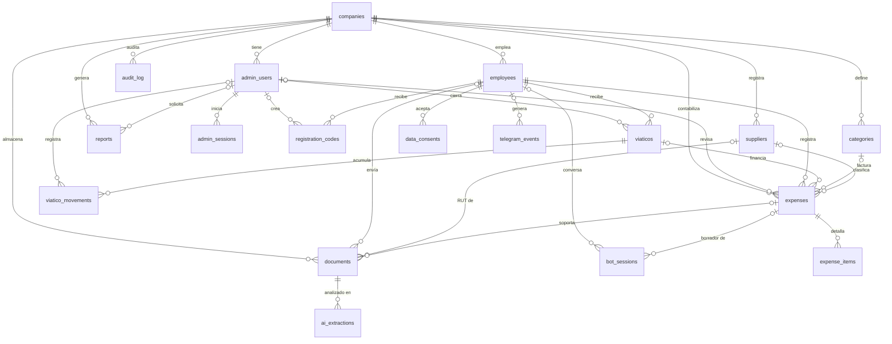
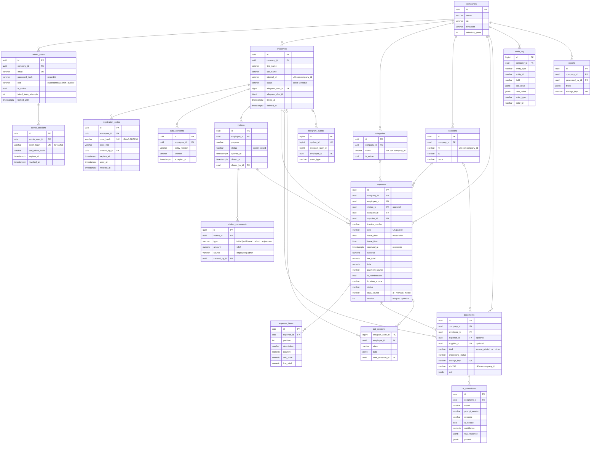

# 03 — Diagrama entidad-relación y modelo relacional

Refleja la migración `e03f1d92d5f6` (esquema inicial). Fuente de verdad: `backend/app/models/`.

> Los diagramas usan [Mermaid](https://mermaid.js.org/). GitHub los dibuja automáticamente;
> en VS Code se ven con la extensión *Markdown Preview Mermaid Support*.

## 1. Vista general (entidades y relaciones)

**Cómo leer las líneas** (notación "pata de gallo"):

| Símbolo | Significado |
|---|---|
| `\|\|` | exactamente uno (obligatorio) |
| `\|o` | cero o uno (opcional) |
| `o{` | cero o muchos |

Ejemplo: `viaticos |o--o{ expenses` significa que un gasto pertenece a **cero o un** viático
(puede pagarse con dinero propio), y un viático tiene **cero o muchos** gastos.

## 2. Diagrama detallado

Para no saturar el diagrama detallado, las relaciones de auditoría hacia `admin_users`
(`created_by_id`, `closed_by_id`, `reviewed_by_id`, `generated_by_id`) solo aparecen en la vista general.

## 3. Modelo relacional

Notación: **PK** clave primaria · **FK** → tabla referenciada · **UK** valor único · `?` admite nulos.
Todas las tablas con `created_at`/`updated_at` los llenan automáticamente con la hora del servidor.

### Empresa y administración

**companies** (**id** PK, name, nit?, timezone, retention_years, created_at, updated_at)

**admin_users** (**id** PK, company_id FK→companies, email UK, full_name, password_hash, role,
is_active, last_login_at?, failed_login_attempts, locked_until?, created_at, updated_at)

**admin_sessions** (**id** PK, admin_user_id FK→admin_users *ON DELETE CASCADE*, token_hash UK,
csrf_token_hash, created_at, expires_at, last_seen_at, ip_address?, user_agent?, revoked_at?)

### Empleados

**employees** (**id** PK, company_id FK→companies, first_name, last_name, internal_id, status,
telegram_user_id? UK, telegram_chat_id?, telegram_username?, linked_at?, deleted_at?, created_at, updated_at)
- UK (company_id, internal_id)

**registration_codes** (**id** PK, employee_id FK→employees *CASCADE*, code_hash UK, code_hint,
created_by_id? FK→admin_users, created_at, expires_at, used_at?, used_by_telegram_user_id?, revoked_at?)
- UK parcial (employee_id) WHERE used_at IS NULL AND revoked_at IS NULL

**data_consents** (**id** PK, employee_id FK→employees *CASCADE*, policy_version, channel, accepted_at)

### Viáticos

**viaticos** (**id** PK, employee_id FK→employees, purpose?, status, opened_at, closed_at?,
closed_by_id? FK→admin_users, created_at, updated_at)

**viatico_movements** (**id** PK, viatico_id FK→viaticos *CASCADE*, type, amount, source, note?,
created_by_id? FK→admin_users, created_at)
- CHECK amount <> 0 AND (amount > 0 OR type = 'adjustment')

### Gastos

**categories** (**id** PK, company_id FK→companies, name, is_active)
- UK (company_id, name)

**suppliers** (**id** PK, company_id FK→companies, nit, dv?, name, created_at, updated_at)
- UK (company_id, nit)

**expenses** (**id** PK, company_id FK→companies, employee_id FK→employees, viatico_id? FK→viaticos,
category_id? FK→categories, supplier_id? FK→suppliers, description?, invoice_number?, cufe?,
issue_date?, issue_time?, subtotal?, tax_total?, total?, currency, received_at, payment_source?,
is_reimbursable, location_lat?, location_lon?, location_text?, location_source, status, data_source,
rejection_reason?, reviewed_by_id? FK→admin_users, reviewed_at?, deleted_at?, version, created_at, updated_at)
- CHECK total IS NULL OR total >= 0
- UK parcial (company_id, cufe) WHERE cufe IS NOT NULL AND deleted_at IS NULL
- UK parcial (company_id, supplier_id, invoice_number) WHERE ambos IS NOT NULL AND deleted_at IS NULL

**expense_items** (**id** PK, expense_id FK→expenses *CASCADE*, position, description, quantity,
unit_price?, line_total?)
- CHECK quantity > 0

### Archivos e IA

**documents** (**id** PK, company_id FK→companies, employee_id? FK→employees,
expense_id? FK→expenses *ON DELETE SET NULL*, supplier_id? FK→suppliers, kind, processing_status,
storage_key UK, mime_type, size_bytes, sha256, width?, height?, original_filename?,
telegram_file_unique_id?, exif?, received_at, retention_until?, deleted_at?, created_at, updated_at)
- UK (company_id, sha256)

**ai_extractions** (**id** PK, document_id FK→documents *CASCADE*, model, prompt_version, outcome,
is_invoice?, confidence?, raw_response?, parsed?, error?, latency_ms?, tokens_in?, tokens_out?, created_at)

### Telegram

**bot_sessions** (**telegram_user_id** PK, employee_id? FK→employees *CASCADE*, state, data,
draft_expense_id? FK→expenses *SET NULL*, updated_at, expires_at?)

**telegram_events** (**id** PK, update_id UK, telegram_user_id, employee_id? FK→employees *SET NULL*,
event_type, received_at)

### Trazabilidad

**audit_log** (**id** PK, company_id FK→companies, entity_type, entity_id, action, field?, old_value?,
new_value?, actor_type, actor_id?, ip_address?, reason?, created_at)
- Índice (entity_type, entity_id). Sin FK hacia la entidad: es **polimórfica** (registra cambios
  de cualquier tabla) y debe conservarse aunque el registro original se archive.

**reports** (**id** PK, company_id FK→companies, generated_by_id? FK→admin_users, filters,
storage_key UK, created_at)

## 4. Decisiones de diseño reflejadas en el modelo

| Decisión | Por qué |
|---|---|
| `documents.expense_id` es opcional | Una foto se guarda **antes** de que exista el gasto, y una que no es factura nunca lo tendrá. |
| `expenses.viatico_id` es opcional | Si el empleado pagó con su dinero, no hay viático (`is_reimbursable = true`). |
| El saldo no es una columna | Se calcula con `viatico_movements` y `expenses`; así no puede desincronizarse. |
| Fecha de expedición ≠ fecha de recepción | `issue_date`/`issue_time` vienen de la factura; `received_at`, de Telegram. |
| `ON DELETE CASCADE` solo en tablas "hijas" puras | Líneas de factura, sesiones o intentos de IA no tienen sentido sin su padre. Gastos, empleados y documentos usan borrado lógico. |
| `bot_sessions` usa `telegram_user_id` como PK | La conversación existe incluso antes de que el usuario se vincule como empleado. |
